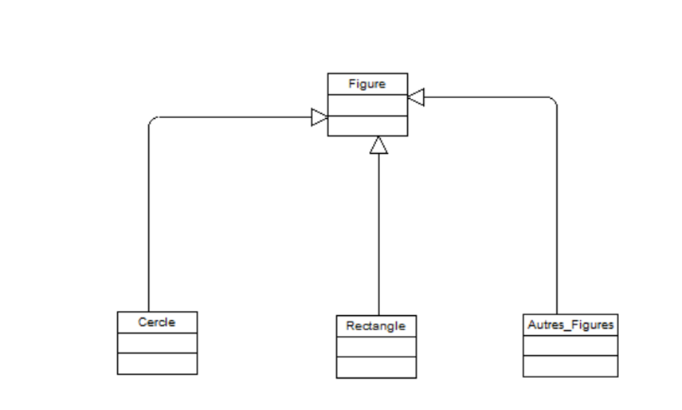
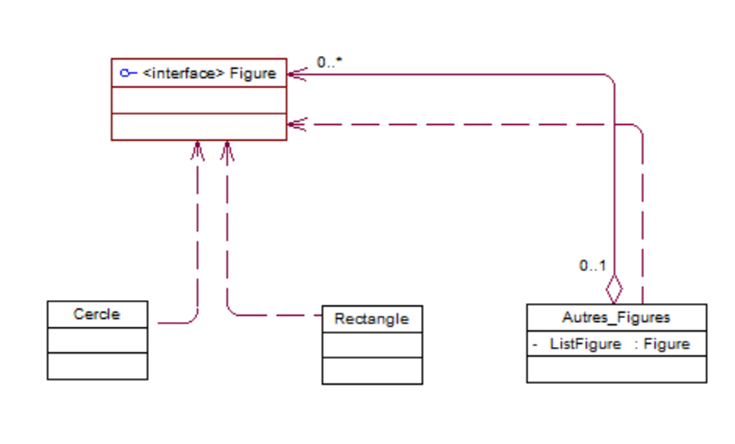
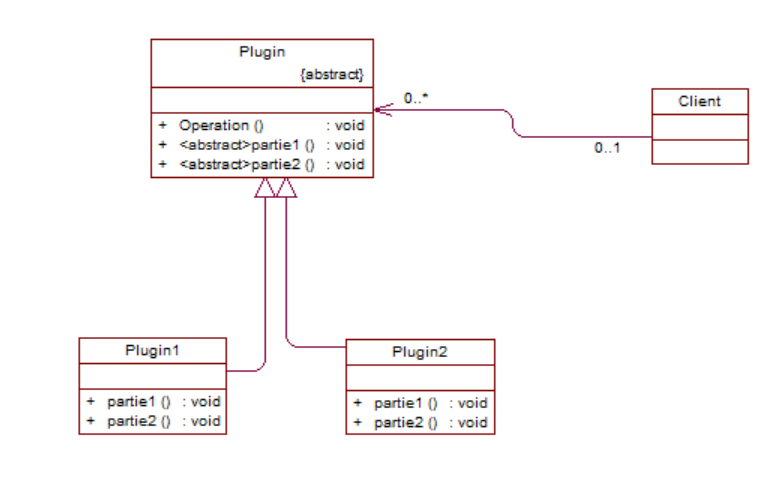
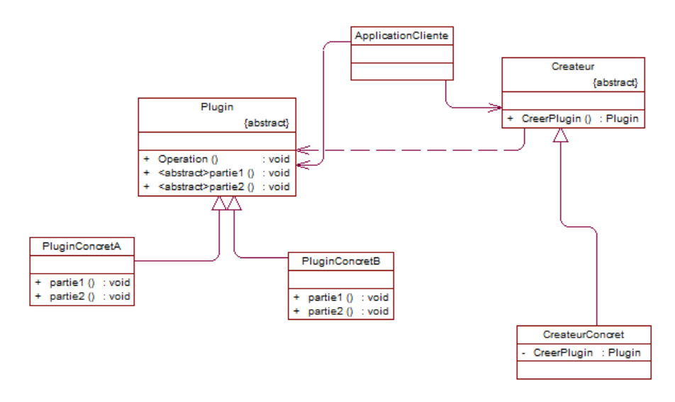
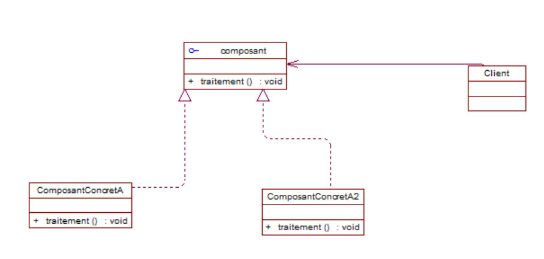
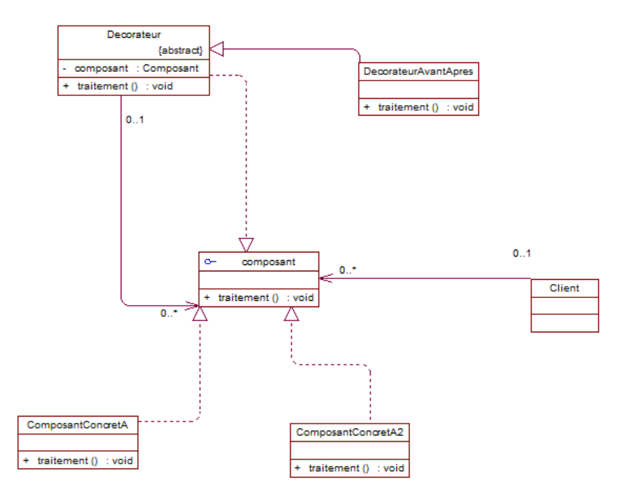
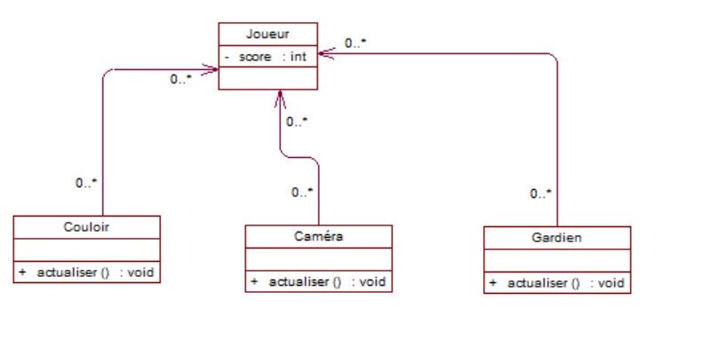
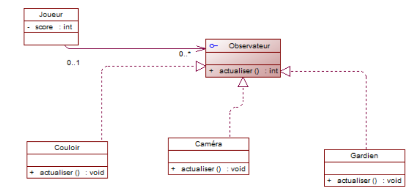

# Rapport d'Exercice : Conception Orientée Objet et Design Patterns

## Situation 1 : Gestion des figures géométriques et des groupes

### 1. Description du Problème
La situation à modéliser est la suivante : 
> *"Une figure peut être soit un cercle, un rectangle ou un groupe de figures."*

### 2. Design Pattern Approprié : Composite
Le pattern **Composite** est un patron de conception structurel qui permet de composer des objets en structures arborescentes pour représenter des hiérarchies de type "tout-partie"[cite: 2]. Son objectif principal est de permettre aux clients de traiter des objets individuels et des compositions d'objets de manière uniforme[cite: 2].

#### Principe d'utilisation :
* **Interface Commune (`Figure`) :** Définit l'interface commune pour toutes les figures[cite: 2].
* **Les Feuilles (`Cercle` et `Rectangle`) :** Représentent les objets primitifs qui implémentent l'interface `Figure`[cite: 1, 2].
* **Le Composite (`Autres_Figures`) :** Représente le groupe de figures. Il implémente l'interface `Figure` et contient une collection d'objets de type `Figure` (`0..*`), permettant de traiter un groupe de la même manière qu'une figure simple[cite: 2].

---

### 3. Diagrammes de Classes

#### A. Première approche (Version initiale)
Ce premier diagramme montre une modélisation préliminaire de la hiérarchie des classes autour de la classe `Figure`.

#### B. Version finale corrigée (Pattern Composite)
Ce second diagramme présente la solution finale correcte en utilisant le pattern Composite :

## Situation 2 : Algorithme squelette et instanciation découplée

### 1. Description du Problème
La situation modélise un plugin avec un algorithme squelette dont certaines parties varient, tout en permettant au client d'instancier les classes concrètes sans les coupler directement.

### 2. Design Patterns Appropriés : Template Method & Factory Method
* **Template Method :** Définit le squelette d'un algorithme en reportant certaines étapes sur les sous-classes.
* **Factory Method :** Permet d'instancier des objets (les plugins) sans spécifier la classe exacte de l'objet qui sera créé.

### 3. Diagrammes de Classes

#### A. Première approche (Version initiale)

#### B. Version finale corrigée

## Situation 3 : Ajout dynamique de responsabilités (Decorateur)

### 1. Description du Problème
La situation consiste à ajouter des responsabilités (traitements avant et après) à un composant existant de manière dynamique, sans modifier son code source.

### 2. Design Pattern Approprié : Decorator
* **Decorator :** Permet d'attacher de nouveaux comportements à un objet en le plaçant dans des objets enveloppeurs qui contiennent ces comportements.

### 3. Diagrammes de Classes

#### A. Première approche (Version initiale)

#### B. Version finale corrigée

## Situation 4 : Notification d'état et couplage faible (Observer)

### 1. Description do Problème
La situation consiste à notifier des objets de l'environnement (`Couloir`, `Caméra`, `Gardien`) des changements de score d'un `Joueur` tout en garantissant un couplage faible.

### 2. Design Pattern Approprié : Observer
* **Observer :** Permet de définir un mécanisme de souscription pour notifier plusieurs objets d'un changement d'état survenant dans l'objet qu'ils observent.

### 3. Diagrammes de Classes

#### A. Première approche (Version initiale)

#### B. Version finale corrigée
